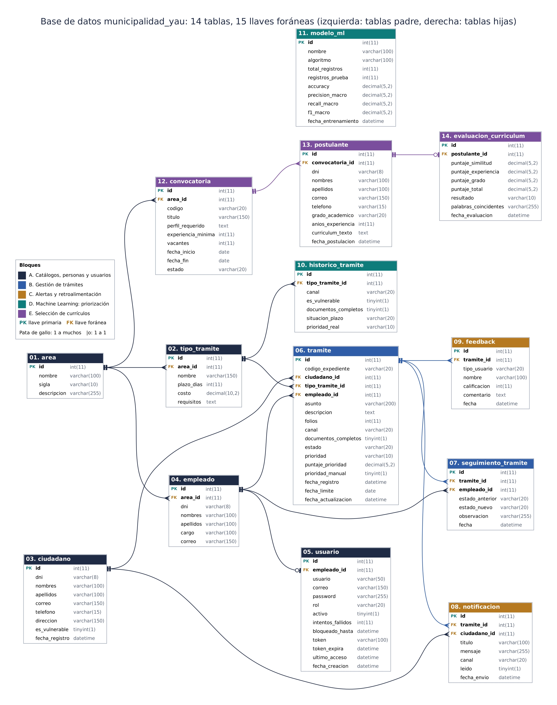

# Sistema de Trámites y Selección de Currículos con Machine Learning
### Municipalidad Provincial de Yau

Trabajo final del curso **Taller de Desarrollo de Aplicaciones con Machine Learning**.

Sistema web que automatiza la gestión documental (trámites) de la municipalidad:

- **Inicio de sesión** con correo o usuario (ID) y contraseña cifrada; roles **Administrador** y **Trabajador**.
- **Prioriza los trámites críticos** con un modelo de Machine Learning (**Naive Bayes**) y ordena la bandeja por urgencia.
- **Avisa al ciudadano** de cada cambio en su expediente (correo / SMS / sistema) y le permite consultar su trámite en línea, con actualización automática.
- **Reduce errores**: valida los datos, muestra los requisitos de cada trámite y guarda el historial completo de cada expediente.
- **Selecciona currículos** comparando cada CV con el perfil de la convocatoria (**TF-IDF + similitud coseno**).
- **Analiza cuellos de botella** por área y por tipo de trámite en un panel de control.

---

## Tecnologías

| Capa | Tecnología |
|---|---|
| Cliente | React (create-react-app), Axios, Bootstrap 5, React-Bootstrap, Bootstrap Icons, SweetAlert2 |
| Servidor | Node.js, Express 5, CORS, mysql |
| Base de datos | MySQL / MariaDB con **XAMPP** (phpMyAdmin) |
| Machine Learning | Naive Bayes y TF-IDF programados en JavaScript (sin librerías externas) |
| Herramientas | Visual Studio Code, GitKraken, GitHub |

---

## Estructura del proyecto

```
sistema-tramites-yau/
├── database/
│   └── municipalidad_yau.sql        ← script completo (14 tablas + datos de prueba)
├── docs/
│   ├── INFORME_PROPUESTA.md         ← propuesta de solución y preguntas guía
│   ├── BASE_DE_DATOS.md             ← diccionario de datos
│   ├── API.md                       ← todas las rutas del servidor
│   ├── GUIA_GIT.md                  ← ramas, GitKraken y GitHub paso a paso
│   ├── diagramas/                   ← ER, arquitectura, flujo y ramas (PNG y SVG)
│   └── integrantes/                 ← guía de estudio de cada integrante
├── server/                          ← Node + Express (puerto 3001)
│   ├── index.js                     ← servidor principal (bloques por integrante)
│   ├── config/db.js                 ← conexión a MySQL
│   ├── middleware/auth.js           ← sesión (token), contraseñas cifradas y roles
│   ├── routes/                      ← rutas de cada módulo
│   └── ml/                          ← modelos de Machine Learning
└── client/                          ← React (puerto 3000)
    ├── public/index.html
    └── src/
        ├── App.js                   ← menú y pantallas (bloques por integrante)
        ├── App.css                  ← sistema de diseño
        ├── config.js                ← URL del servidor y funciones de formato
        └── components/              ← pantallas de cada módulo
```

---

## Cómo ejecutar el proyecto

### 1. Base de datos (XAMPP)
1. Abre **XAMPP** y enciende **Apache** y **MySQL**.
2. Entra a `http://localhost/phpmyadmin`.
3. Pestaña **Importar** → elige `database/municipalidad_yau.sql` → **Continuar**.
   El script crea la base `municipalidad_yau` con sus 14 tablas y datos de prueba.

### 2. Servidor
```bash
cd server
npm install
node index.js
```
Debe aparecer: `corriendo en el puerto 3001` y `Conectado a la base de datos municipalidad_yau`.

### 3. Cliente
En otra terminal:
```bash
cd client
npm install
npm start
```
Se abre `http://localhost:3000`.

> Para detener el servidor: **CTRL + C** y vuelves a ejecutar `node index.js`.

### Usuarios para iniciar sesión

| Rol | Usuario (ID) | Correo | Contraseña |
|---|---|---|---|
| Administrador | `admin` | admin@muniyau.gob.pe | `Admin2026!` |
| Administrador (RR. HH.) | `pgomez` | pgomez@muniyau.gob.pe | `Yau2026!` |
| Trabajador (mesa de partes) | `aparedes` | aparedes@muniyau.gob.pe | `Yau2026!` |
| Trabajador (tributación) | `jsalazar` | jsalazar@muniyau.gob.pe | `Yau2026!` |

- **Administrador:** ve todo, gestiona usuarios y catálogos, entrena el modelo y evalúa CV.
- **Trabajador:** panel, ciudadanos, bandeja de expedientes, alertas y opiniones.
- 5 intentos fallidos bloquean la cuenta 5 minutos. La sesión dura 8 horas.
- El **ciudadano no necesita cuenta**: en el login pulsa *¿Eres ciudadano? Consulta tu expediente*.

### Datos para probar
- Consulta ciudadana: expediente **EXP-2026-000004** con DNI **08765432**.
- Bandeja de expedientes → **Atender** un expediente y, en otra pestaña, déjalo abierto en *Consultar expediente*: la alerta llega sola en 10 segundos.
- Evaluación de CV → elige **CAS-002-2026** → **Evaluar CV**.

---

## Equipo y ramas

| Integrante | Rama | Módulo |
|---|---|---|
| Integrante 1 (Master / dueño del repositorio) | `developF` | Base del proyecto, base de datos, **login y usuarios**, catálogos, panel de control, opiniones |
| Integrante 2 | `developM` | Trámites + Machine Learning de priorización (Naive Bayes) |
| Integrante 3 | `developR` | Alertas al ciudadano + selección de currículos (TF-IDF) |

Flujo: `main` → `developer` → `developF` / `developM` / `developR`. Detalle en [docs/GUIA_GIT.md](docs/GUIA_GIT.md).

---

## Documentación
- [Propuesta de solución y preguntas guía](docs/INFORME_PROPUESTA.md)
- [Base de datos (diccionario de datos)](docs/BASE_DE_DATOS.md)
- [Rutas de la API](docs/API.md)
- [Guía de Git (GitKraken + GitHub)](docs/GUIA_GIT.md)


