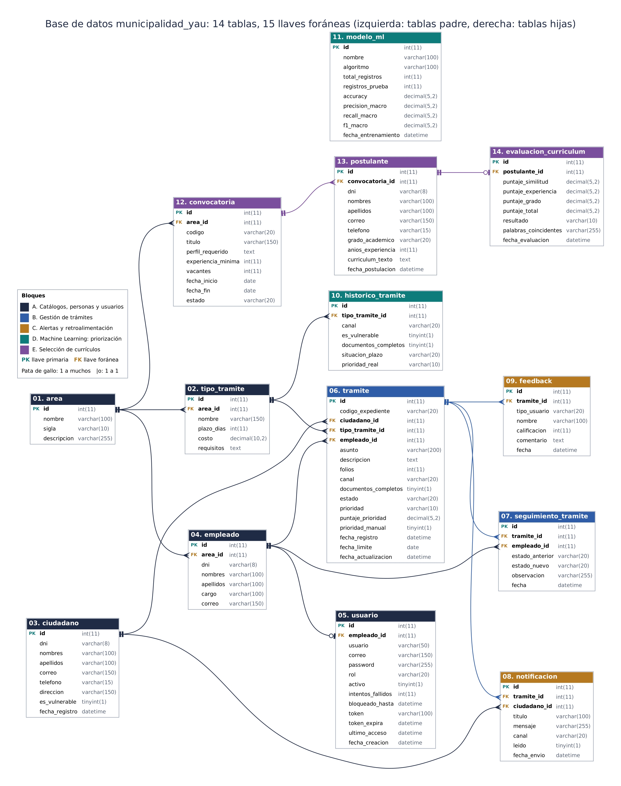

# Base de datos `municipalidad_yau`

Motor: MySQL / MariaDB (XAMPP). Cotejamiento: `utf8mb4_general_ci`. Motor de tablas: InnoDB (permite llaves foráneas).

## Convenciones (estándar del curso)

- Tablas en **singular** y minúsculas (`empleado`, no `empleados`).
- Llave primaria: `id int(11) NOT NULL AUTO_INCREMENT`.
- Llave foránea: `<tabla>_id` (por ejemplo `area_id`, `ciudadano_id`).
- Textos cortos `varchar(100)`, correos `varchar(150)`, textos largos `text`, montos `decimal(10,2)`.
- Las tablas se crean **en orden de dependencia**: primero las que no dependen de nadie (padres) y luego las que tienen llaves foráneas (hijas). Así el script se importa sin errores.

## Orden de creación

El script completo lo mantiene el **Integrante 1 (Master)**; la última columna indica qué módulo usa cada tabla.

| N.° | Tabla | Bloque | Depende de | Módulo que la usa |
|---|---|---|---|---|
| 01 | `area` | A. Catálogos, personas y usuarios | — | Integrante 1 |
| 02 | `tipo_tramite` | A. Catálogos, personas y usuarios | `area` | Integrante 1 |
| 03 | `ciudadano` | A. Catálogos, personas y usuarios | — | Integrante 1 |
| 04 | `empleado` | A. Catálogos, personas y usuarios | `area` | Integrante 1 |
| 05 | `usuario` | A. Catálogos, personas y usuarios | `empleado` | Integrante 1 |
| 06 | `tramite` | B. Gestión de trámites | `ciudadano`, `empleado`, `tipo_tramite` | Integrante 2 |
| 07 | `seguimiento_tramite` | B. Gestión de trámites | `empleado`, `tramite` | Integrante 2 |
| 08 | `notificacion` | C. Alertas y retroalimentación | `ciudadano`, `tramite` | Integrante 3 |
| 09 | `feedback` | C. Alertas y retroalimentación | `tramite` | Integrante 1 |
| 10 | `historico_tramite` | D. Machine Learning | `tipo_tramite` | Integrante 2 |
| 11 | `modelo_ml` | D. Machine Learning | — | Integrante 2 |
| 12 | `convocatoria` | E. Selección de currículos | `area` | Integrante 3 |
| 13 | `postulante` | E. Selección de currículos | `convocatoria` | Integrante 3 |
| 14 | `evaluacion_curriculum` | E. Selección de currículos | `postulante` | Integrante 3 |

## Diccionario de datos

### 01. `area`

gerencias / oficinas de la municipalidad

| Campo | Tipo | Nulo | Llave | Descripción / regla |
|---|---|---|---|---|
| `id` | int(11) | No | PK | autoincremental |
| `nombre` | varchar(100) | No | UNIQUE |  |
| `sigla` | varchar(10) | No |  |  |
| `descripcion` | varchar(255) | Sí |  |  |

### 02. `tipo_tramite`

procedimientos del TUPA con plazo y costo

| Campo | Tipo | Nulo | Llave | Descripción / regla |
|---|---|---|---|---|
| `id` | int(11) | No | PK | autoincremental |
| `area_id` | int(11) | No | FK → `area.id` |  |
| `nombre` | varchar(150) | No |  |  |
| `plazo_dias` | int(11) | No |  |  |
| `costo` | decimal(10,2) | No |  | por defecto 0.00 |
| `requisitos` | text | Sí |  |  |

Reglas de integridad:
- `area_id` → `area`: al eliminar el padre **RESTRICT**.

### 03. `ciudadano`

persona natural que realiza tramites

| Campo | Tipo | Nulo | Llave | Descripción / regla |
|---|---|---|---|---|
| `id` | int(11) | No | PK | autoincremental |
| `dni` | varchar(8) | No | UNIQUE |  |
| `nombres` | varchar(100) | No |  |  |
| `apellidos` | varchar(100) | No |  |  |
| `correo` | varchar(150) | Sí |  |  |
| `telefono` | varchar(15) | Sí |  |  |
| `direccion` | varchar(150) | Sí |  |  |
| `es_vulnerable` | tinyint(1) | No |  | por defecto 0 |
| `fecha_registro` | datetime | No |  | por defecto CURRENT_TIMESTAMP |

### 04. `empleado`

personal municipal que atiende los tramites

| Campo | Tipo | Nulo | Llave | Descripción / regla |
|---|---|---|---|---|
| `id` | int(11) | No | PK | autoincremental |
| `area_id` | int(11) | No | FK → `area.id` |  |
| `dni` | varchar(8) | No | UNIQUE |  |
| `nombres` | varchar(100) | No |  |  |
| `apellidos` | varchar(100) | No |  |  |
| `cargo` | varchar(100) | No |  |  |
| `correo` | varchar(150) | Sí |  |  |

Reglas de integridad:
- `area_id` → `area`: al eliminar el padre **RESTRICT**.

### 05. `usuario`

cuentas para iniciar sesion (correo o usuario + contraseña)

| Campo | Tipo | Nulo | Llave | Descripción / regla |
|---|---|---|---|---|
| `id` | int(11) | No | PK | autoincremental |
| `empleado_id` | int(11) | Sí | FK → `empleado.id` (UNIQUE, 1 a 1) |  |
| `usuario` | varchar(50) | No | UNIQUE |  |
| `correo` | varchar(150) | No | UNIQUE |  |
| `password` | varchar(255) | No |  |  |
| `rol` | varchar(20) | No |  | por defecto 'TRABAJADOR' |
| `activo` | tinyint(1) | No |  | por defecto 1 |
| `intentos_fallidos` | int(11) | No |  | por defecto 0 |
| `bloqueado_hasta` | datetime | Sí |  |  |
| `token` | varchar(100) | Sí |  |  |
| `token_expira` | datetime | Sí |  |  |
| `ultimo_acceso` | datetime | Sí |  |  |
| `fecha_creacion` | datetime | No |  | por defecto CURRENT_TIMESTAMP |

Reglas de integridad:
- `empleado_id` → `empleado`: al eliminar el padre **SET NULL**.

### 06. `tramite`

expediente presentado por un ciudadano

| Campo | Tipo | Nulo | Llave | Descripción / regla |
|---|---|---|---|---|
| `id` | int(11) | No | PK | autoincremental |
| `codigo_expediente` | varchar(20) | Sí | UNIQUE |  |
| `ciudadano_id` | int(11) | No | FK → `ciudadano.id` |  |
| `tipo_tramite_id` | int(11) | No | FK → `tipo_tramite.id` |  |
| `empleado_id` | int(11) | Sí | FK → `empleado.id` |  |
| `asunto` | varchar(200) | No |  |  |
| `descripcion` | text | Sí |  |  |
| `folios` | int(11) | No |  | por defecto 1 |
| `canal` | varchar(20) | No |  | por defecto 'PRESENCIAL' |
| `documentos_completos` | tinyint(1) | No |  | por defecto 1 |
| `estado` | varchar(20) | No |  | por defecto 'REGISTRADO' |
| `prioridad` | varchar(10) | No |  | por defecto 'MEDIA' |
| `puntaje_prioridad` | decimal(5,2) | No |  | por defecto 0.00 |
| `prioridad_manual` | tinyint(1) | No |  | por defecto 0 |
| `fecha_registro` | datetime | No |  | por defecto CURRENT_TIMESTAMP |
| `fecha_limite` | date | Sí |  |  |
| `fecha_actualizacion` | datetime | Sí |  |  |

Reglas de integridad:
- `ciudadano_id` → `ciudadano`: al eliminar el padre **RESTRICT**.
- `tipo_tramite_id` → `tipo_tramite`: al eliminar el padre **RESTRICT**.
- `empleado_id` → `empleado`: al eliminar el padre **SET NULL**.

### 07. `seguimiento_tramite`

historial de cambios de estado (trazabilidad)

| Campo | Tipo | Nulo | Llave | Descripción / regla |
|---|---|---|---|---|
| `id` | int(11) | No | PK | autoincremental |
| `tramite_id` | int(11) | No | FK → `tramite.id` |  |
| `empleado_id` | int(11) | Sí | FK → `empleado.id` |  |
| `estado_anterior` | varchar(20) | Sí |  |  |
| `estado_nuevo` | varchar(20) | No |  |  |
| `observacion` | varchar(255) | Sí |  |  |
| `fecha` | datetime | No |  | por defecto CURRENT_TIMESTAMP |

Reglas de integridad:
- `tramite_id` → `tramite`: al eliminar el padre **CASCADE**.
- `empleado_id` → `empleado`: al eliminar el padre **SET NULL**.

### 08. `notificacion`

alertas enviadas al ciudadano sobre su tramite

| Campo | Tipo | Nulo | Llave | Descripción / regla |
|---|---|---|---|---|
| `id` | int(11) | No | PK | autoincremental |
| `tramite_id` | int(11) | No | FK → `tramite.id` |  |
| `ciudadano_id` | int(11) | No | FK → `ciudadano.id` |  |
| `titulo` | varchar(100) | No |  |  |
| `mensaje` | varchar(255) | No |  |  |
| `canal` | varchar(20) | No |  | por defecto 'SISTEMA' |
| `leido` | tinyint(1) | No |  | por defecto 0 |
| `fecha_envio` | datetime | No |  | por defecto CURRENT_TIMESTAMP |

Reglas de integridad:
- `tramite_id` → `tramite`: al eliminar el padre **CASCADE**.
- `ciudadano_id` → `ciudadano`: al eliminar el padre **CASCADE**.

### 09. `feedback`

opinion del ciudadano o del personal (mejora continua)

| Campo | Tipo | Nulo | Llave | Descripción / regla |
|---|---|---|---|---|
| `id` | int(11) | No | PK | autoincremental |
| `tramite_id` | int(11) | Sí | FK → `tramite.id` |  |
| `tipo_usuario` | varchar(20) | No |  |  |
| `nombre` | varchar(100) | No |  |  |
| `calificacion` | int(11) | No |  |  |
| `comentario` | text | Sí |  |  |
| `fecha` | datetime | No |  | por defecto CURRENT_TIMESTAMP |

Reglas de integridad:
- `tramite_id` → `tramite`: al eliminar el padre **SET NULL**.
- `calificacion` solo acepta valores de 1 a 5 (CHECK).

### 10. `historico_tramite`

dataset historico etiquetado para entrenar

| Campo | Tipo | Nulo | Llave | Descripción / regla |
|---|---|---|---|---|
| `id` | int(11) | No | PK | autoincremental |
| `tipo_tramite_id` | int(11) | No | FK → `tipo_tramite.id` |  |
| `canal` | varchar(20) | No |  |  |
| `es_vulnerable` | tinyint(1) | No |  |  |
| `documentos_completos` | tinyint(1) | No |  |  |
| `situacion_plazo` | varchar(20) | No |  |  |
| `prioridad_real` | varchar(10) | No |  |  |

Reglas de integridad:
- `tipo_tramite_id` → `tipo_tramite`: al eliminar el padre **CASCADE**.

### 11. `modelo_ml`

se llena automaticamente al entrenar desde el sistema

| Campo | Tipo | Nulo | Llave | Descripción / regla |
|---|---|---|---|---|
| `id` | int(11) | No | PK | autoincremental |
| `nombre` | varchar(100) | No |  |  |
| `algoritmo` | varchar(100) | No |  |  |
| `total_registros` | int(11) | No |  |  |
| `registros_prueba` | int(11) | No |  |  |
| `accuracy` | decimal(5,2) | No |  |  |
| `precision_macro` | decimal(5,2) | No |  |  |
| `recall_macro` | decimal(5,2) | No |  |  |
| `f1_macro` | decimal(5,2) | No |  |  |
| `fecha_entrenamiento` | datetime | No |  | por defecto CURRENT_TIMESTAMP |

### 12. `convocatoria`

proceso de seleccion de personal (CAS)

| Campo | Tipo | Nulo | Llave | Descripción / regla |
|---|---|---|---|---|
| `id` | int(11) | No | PK | autoincremental |
| `area_id` | int(11) | No | FK → `area.id` |  |
| `codigo` | varchar(20) | No | UNIQUE |  |
| `titulo` | varchar(150) | No |  |  |
| `perfil_requerido` | text | No |  |  |
| `experiencia_minima` | int(11) | No |  | por defecto 0 |
| `vacantes` | int(11) | No |  | por defecto 1 |
| `fecha_inicio` | date | No |  |  |
| `fecha_fin` | date | No |  |  |
| `estado` | varchar(20) | No |  | por defecto 'ABIERTA' |

Reglas de integridad:
- `area_id` → `area`: al eliminar el padre **RESTRICT**.

### 13. `postulante`

persona que postula a una convocatoria con su CV

| Campo | Tipo | Nulo | Llave | Descripción / regla |
|---|---|---|---|---|
| `id` | int(11) | No | PK | autoincremental |
| `convocatoria_id` | int(11) | No | FK → `convocatoria.id` (UNIQUE, 1 a 1) |  |
| `dni` | varchar(8) | No | UNIQUE |  |
| `nombres` | varchar(100) | No |  |  |
| `apellidos` | varchar(100) | No |  |  |
| `correo` | varchar(150) | Sí |  |  |
| `telefono` | varchar(15) | Sí |  |  |
| `grado_academico` | varchar(20) | No |  |  |
| `anios_experiencia` | int(11) | No |  | por defecto 0 |
| `curriculum_texto` | text | No |  |  |
| `fecha_postulacion` | datetime | No |  | por defecto CURRENT_TIMESTAMP |

Reglas de integridad:
- `convocatoria_id` → `convocatoria`: al eliminar el padre **CASCADE**.

### 14. `evaluacion_curriculum`

se llena automaticamente al evaluar los CV desde el sistema

| Campo | Tipo | Nulo | Llave | Descripción / regla |
|---|---|---|---|---|
| `id` | int(11) | No | PK | autoincremental |
| `postulante_id` | int(11) | No | FK → `postulante.id` (UNIQUE, 1 a 1) |  |
| `puntaje_similitud` | decimal(5,2) | No |  |  |
| `puntaje_experiencia` | decimal(5,2) | No |  |  |
| `puntaje_grado` | decimal(5,2) | No |  |  |
| `puntaje_total` | decimal(5,2) | No |  |  |
| `resultado` | varchar(10) | No |  |  |
| `palabras_coincidentes` | varchar(255) | Sí |  |  |
| `fecha_evaluacion` | datetime | No |  | por defecto CURRENT_TIMESTAMP |

Reglas de integridad:
- `postulante_id` → `postulante`: al eliminar el padre **CASCADE**.
