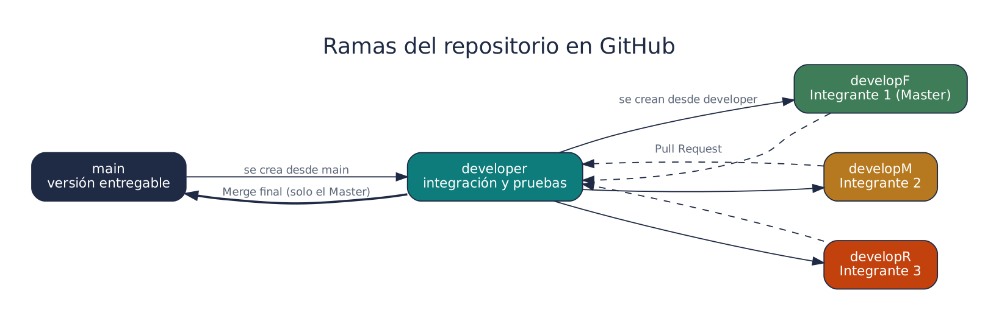

# Guía de Git: GitKraken + GitHub



## Modelo de ramas

| Rama | Quién la usa | Para qué |
|---|---|---|
| `main` | Solo el **Master** | Versión final que se entrega al profesor. Nadie programa aquí. |
| `developer` | Solo el **Master** hace merge | Integra el trabajo de los tres y se prueba todo junto. |
| `developF` | Integrante 1 (Master) | Su módulo: base, base de datos, catálogos, dashboard, opiniones. |
| `developM` | Integrante 2 | Trámites + Machine Learning de prioridad. |
| `developR` | Integrante 3 | Alertas + selección de currículos. |

**Regla de oro:** cada uno trabaja SOLO en su rama. Los cambios llegan a `developer` mediante **Pull Request** y el Master los aprueba.

---

## Por qué no habrá conflictos

1. Cada integrante tiene **sus propios archivos** (sus rutas, sus componentes y sus modelos de ML).
2. Los únicos archivos compartidos son `server/index.js` y `client/src/App.js`. El Master ya dejó en ellos un **bloque comentado** para cada integrante; cada uno solo **descomenta su bloque**. Como los bloques están separados, Git los combina solo.

Ejemplo en `server/index.js` (Integrante 2):
```js
// const tramiteRoutes = require("./routes/tramiteRoutes");   ← quitar las //
// const modeloRoutes = require("./routes/modeloRoutes");
// app.use(tramiteRoutes);
// app.use(modeloRoutes);
```
Ejemplo en `client/src/App.js` (bloques JSX): borrar solo las líneas `{/*` y `*/}` que encierran su menú y sus pantallas, y quitar `//` de sus `import`.

> Esto ya se probó: los tres merges se hicieron sin conflictos y el sistema compiló.

---

## PASO 1: el Master crea el repositorio (solo Integrante 1)

### En GitHub
1. **New repository** → nombre `sistema-tramites-yau` → **Private** → sin README (ya lo trae el proyecto) → **Create repository**.
2. **Settings → Collaborators → Add people**: invitar al Integrante 2 y al Integrante 3.

### En GitKraken
1. Descomprime `INTEGRANTE_1_MASTER_developF.zip` en tu carpeta de proyectos.
2. GitKraken → **File → Init Repo** → elige la carpeta `sistema-tramites-yau` → **Create Repository**.
3. En el panel de cambios: **Stage all changes** → mensaje:
   `chore: estructura base, base de datos y modulo del Master` → **Commit**.
4. **Remote → +** → pega la URL de GitHub (`https://github.com/TU_USUARIO/sistema-tramites-yau.git`) → nombre `origin`.
5. **Push** la rama `main`.

### Crear las ramas
En GitKraken, clic derecho sobre `main` → **Create branch here**:
1. `developer` → **Push** (clic derecho → Push).
2. Estando en `developer`, clic derecho → **Create branch here**: `developF`, `developM`, `developR` → **Push** cada una.

### Proteger las ramas (recomendado)
GitHub → **Settings → Branches → Add rule**:
- `main` y `developer`: marcar **Require a pull request before merging**.

> **Importante:** el Master sube su módulo completo en el commit inicial porque es la base que todos necesitan (la base de datos y la conexión). Por eso `developF` arranca ya con su trabajo; en adelante el Master hace sus cambios nuevos en `developF`, igual que los demás.

---

## PASO 2: cada integrante sube su módulo (Integrante 2 y 3)

1. GitKraken → **File → Clone Repo → GitHub.com** → `sistema-tramites-yau` → **Clone**.
2. En el panel izquierdo (**REMOTE → origin**) doble clic en **su rama** (`developM` o `developR`) → *Checkout*.
3. Descomprime **su zip** y copia las carpetas `server/` y `client/` **encima** del proyecto clonado (solo agrega archivos nuevos, no reemplaza nada del Master).
4. Abre el proyecto en **Visual Studio Code** y **descomenta sus bloques** en `server/index.js` y `client/src/App.js` (instrucciones exactas en su archivo `LEEME`).
5. Prueba que funcione (`node index.js` y `npm start`).
6. GitKraken → **Stage all changes** → mensaje de commit (ver abajo) → **Commit** → **Push**.
7. En GitHub aparecerá **Compare & pull request** → base: `developer` ← compare: `developM` (o `developR`) → **Create pull request**.

---

## PASO 3: el Master integra (solo Integrante 1)

1. GitHub → **Pull requests** → abre el PR → revisa **Files changed** → **Merge pull request** → **Confirm**.
2. Orden recomendado: primero `developM`, luego `developR` (pero cualquier orden funciona).
3. En GitKraken: checkout `developer` → **Pull** → probar todo el sistema junto.
4. Si todo funciona: PR de `developer` → `main` → **Merge**. Esa es la versión de entrega.
5. Para que cada integrante tenga lo último: en su rama, clic derecho sobre `developer` → **Merge developer into developM** (o developR / developF) → Push.

---

## Mensajes de commit (convención)

| Prefijo | Uso | Ejemplo |
|---|---|---|
| `feat:` | Nueva funcionalidad | `feat: modulo de tramites con prioridad Naive Bayes` |
| `fix:` | Corrección | `fix: validacion de DNI en ciudadanos` |
| `style:` | Diseño / CSS | `style: colores de prioridad en la bandeja` |
| `docs:` | Documentación | `docs: guia de estudio del integrante 3` |
| `chore:` | Configuración | `chore: estructura base del proyecto` |

---

## Si aparece un conflicto en GitKraken
1. GitKraken muestra el archivo en rojo → clic → se abre el editor de conflictos.
2. Marca las líneas que se deben conservar de **cada lado** (en nuestros bloques normalmente son **ambas**).
3. **Save** → **Mark resolved** → **Commit** → **Push**.

## Lo que NUNCA se sube
`node_modules/` y `client/build/` ya están en `.gitignore`. Después de clonar, cada uno ejecuta `npm install` en `server` y en `client`.
