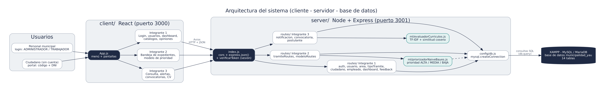
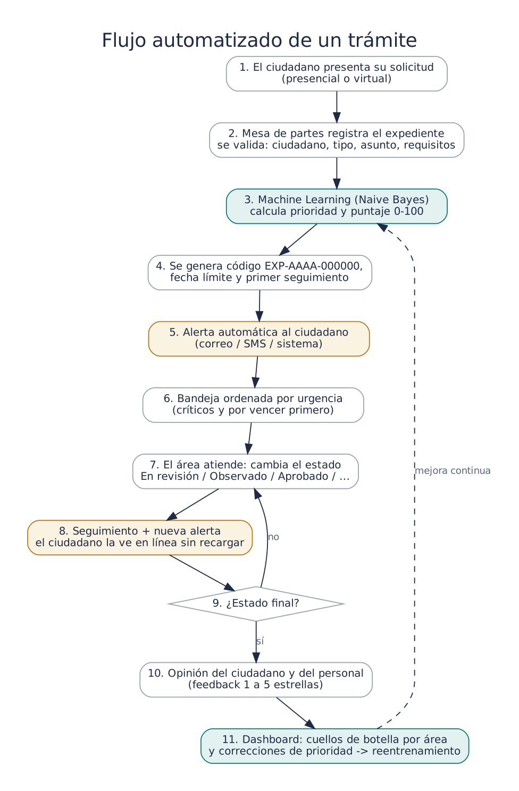
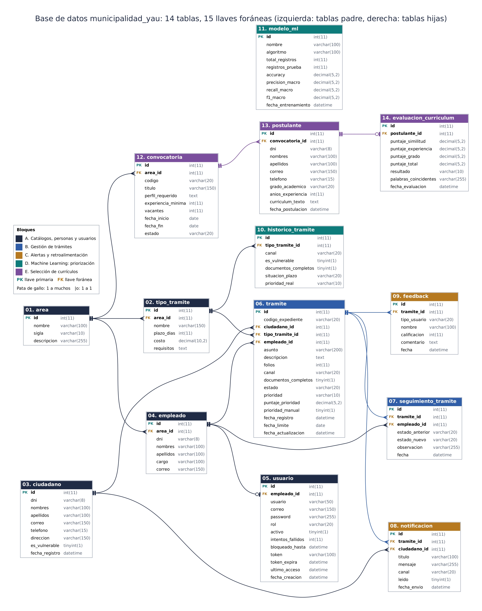

# Propuesta de solución
## Implementación de un sistema automatizado de gestión documental y selección de currículos mediante Machine Learning en la Municipalidad Provincial de Yau

**Curso:** Taller de Desarrollo de Aplicaciones con Machine Learning
**Equipo:** Integrante 1 (Master), Integrante 2, Integrante 3

---

## 1. Problema

La Municipalidad Provincial de Yau atiende sus trámites de forma manual. Esto provoca:

- Largas colas y expedientes que se atienden por orden de llegada, no por urgencia.
- Errores frecuentes: expedientes incompletos, derivados al área equivocada o sin seguimiento.
- Falta de transparencia: el ciudadano no sabe en qué va su trámite y tiene que acercarse a preguntar.
- Sin datos para detectar cuellos de botella ni áreas críticas.
- La selección de personal (CAS) revisa currículos a mano, lo que es lento y poco objetivo.

## 2. Objetivo de la solución

Implementar un sistema web que:

1. **Automatice la gestión de trámites**: registro, código de expediente, plazo legal, seguimiento y estados.
2. **Priorice los trámites críticos con Machine Learning** (Naive Bayes) para atender primero lo urgente y reducir vencimientos.
3. **Notifique al ciudadano** cada cambio de estado (correo, SMS y consulta en línea con actualización automática).
4. **Reduzca errores** con validaciones, requisitos visibles en el registro y trazabilidad de cada acción.
5. **Apoye la selección de currículos** comparando cada CV con el perfil del puesto (TF-IDF y similitud coseno).
6. **Proteja los datos** con inicio de sesión, roles, contraseñas cifradas y consulta ciudadana con código + DNI.

## 3. Arquitectura

| Capa | Tecnología | Función |
|---|---|---|
| Cliente | React + Axios + Bootstrap + SweetAlert2 | Pantallas del personal y portal del ciudadano |
| Servidor | Node.js + Express | API REST, seguridad (token), reglas de negocio y modelos de ML |
| Datos | MySQL / MariaDB (XAMPP) | 14 tablas normalizadas con llaves foráneas |

**Escalabilidad (condición 1 del caso):** el sistema usa la infraestructura que la municipalidad ya tiene (PC con XAMPP y navegador). Al ser cliente-servidor, se puede pasar a un servidor central o a la nube sin cambiar el código; cada módulo es un archivo de rutas independiente, así que se pueden agregar módulos nuevos sin tocar los existentes.

**Adaptación a los flujos actuales (condición 2):** el sistema respeta el flujo real: *mesa de partes → área responsable → resolución → entrega*. Los estados (Registrado, En revisión, Observado, Aprobado, Rechazado, Finalizado) son los mismos que ya usa el personal, y los tipos de trámite con sus plazos salen del TUPA.

## 4. Flujo automatizado de un trámite

## 5. Base de datos

14 tablas en 5 bloques, creadas en orden de dependencia (primero las tablas padre). Detalle en [BASE_DE_DATOS.md](BASE_DE_DATOS.md).

## 6. Modelos de Machine Learning

### 6.1 Priorización de trámites: Naive Bayes categórico

| Elemento | Detalle |
|---|---|
| Tipo de problema | Clasificación supervisada en 3 clases: ALTA, MEDIA, BAJA |
| Datos de entrenamiento | Tabla `historico_tramite` (240 casos etiquetados) |
| Variables | tipo de trámite, canal, atención preferente, requisitos completos, situación del plazo |
| Algoritmo | Teorema de Bayes con suavizado de Laplace y logaritmos |
| Validación | 80% entrenamiento / 20% prueba |
| Salida | Prioridad + probabilidades + puntaje 0-100 para ordenar la bandeja |
| Aprendizaje continuo | Cada corrección del personal se agrega al dataset y se reentrena |

**Resultados obtenidos (48 casos de prueba):**

| Métrica | Valor |
|---|---|
| Exactitud (accuracy) | 75.00% |
| Precisión (promedio) | 78.49% |
| Sensibilidad / recall (promedio) | 76.20% |
| F1 (promedio) | 76.27% |

La prioridad ALTA tiene 88.9% de precisión: cuando el modelo dice que un trámite es crítico, casi siempre lo es.

### 6.2 Selección de currículos: TF-IDF + similitud coseno

1. Se limpia el texto (minúsculas, sin tildes, sin palabras vacías).
2. Cada CV y el perfil se convierten en vectores TF-IDF.
3. La similitud coseno mide cuánto se parece cada CV al perfil (0 a 100).
4. Puntaje final = 60% similitud + 25% experiencia + 15% grado académico.
5. **APTO** si cumple la experiencia mínima y tiene 55 puntos o más.

El sistema **recomienda**; la decisión final es del comité de selección (uso responsable de la IA).

---

## 7. Respuestas a las preguntas guía

### 1) ¿Cuáles son los principales trámites que generan más retrasos y frustración entre los ciudadanos?

Según el análisis de los datos del sistema (pantalla **Panel de control → Trámites que más demoran** y **Cuellos de botella por área**):

| Trámite | Por qué demora |
|---|---|
| Inspección técnica de seguridad (ITSE) | Requiere visita de campo y suele observarse por falta del plan de seguridad. |
| Licencia de funcionamiento | Depende de la ITSE y de varias áreas. |
| Licencia de edificación | Revisión técnica de planos; muchos folios. |
| Reclamos tributarios y fraccionamientos | Alto volumen; el ciudadano vuelve varias veces. |
| Acceso a la información pública | Plazo legal corto (10 días, Ley 27806); si vence hay responsabilidad. |

La frustración aumenta cuando el expediente es **observado** y el ciudadano no se entera. Por eso el sistema le avisa en el momento y le dice qué subsanar.

### 2) ¿Qué datos históricos son necesarios para entrenar el modelo y cómo se recolectan?

**Datos necesarios** (tabla `historico_tramite`):
- Tipo de trámite y área responsable.
- Canal de ingreso (presencial / virtual).
- Si el ciudadano requiere atención preferente (adulto mayor, discapacidad, gestante).
- Si presentó todos los requisitos.
- Situación del plazo (a tiempo, por vencer, vencido).
- **Etiqueta:** la prioridad real que le asignaron los especialistas.

**Cómo se recolectan:**
1. **Digitalización** de los cuadernos de registro de mesa de partes de los últimos 1 a 2 años.
2. **Etiquetado por expertos:** jefes de área clasifican una muestra como ALTA, MEDIA o BAJA.
3. **Recolección continua:** cada trámite nuevo queda registrado con estos datos; cuando el personal corrige una prioridad, ese caso se guarda automáticamente en el dataset.
4. **Calidad:** el sistema valida los campos obligatorios para que no entren datos incompletos.

### 3) ¿Qué métricas se usarán para evaluar la efectividad del sistema?

**Métricas del modelo** (pantalla *Modelo de prioridad*):
- **Exactitud (accuracy):** porcentaje total de aciertos.
- **Precisión:** de los que el modelo marcó como críticos, cuántos lo eran.
- **Sensibilidad (recall):** de los críticos reales, cuántos detectó. Es la más importante: un crítico no detectado puede vencer.
- **F1:** balance entre precisión y sensibilidad.
- **Matriz de confusión:** muestra en qué se confunde el modelo.

**Métricas del servicio** (Panel de control):
- Expedientes vencidos y pendientes por área.
- Días promedio de atención por tipo de trámite comparados con su plazo legal.
- Satisfacción promedio (1 a 5) de ciudadanos y personal.
- Porcentaje de alertas leídas por los ciudadanos.

**Meta inicial:** reducir los expedientes vencidos en 50% y lograr una satisfacción mayor a 4 de 5 en el primer semestre.

### 4) ¿Cómo se garantizará la aceptación y uso del nuevo sistema por parte del personal?

1. **Diseño pensado en el usuario:** tipografía de alta legibilidad, pantallas simples, colores que indican urgencia y mensajes claros.
2. **Roles:** cada trabajador ve solo lo que necesita (bandeja, ciudadanos, alertas); el administrador gestiona el resto.
3. **Capacitación por etapas:** talleres cortos por área, manual de usuario y un "usuario líder" por gerencia.
4. **Implementación piloto:** empezar con Mesa de Partes y Licencias, medir resultados y luego extender a todas las áreas.
5. **El personal mantiene el control:** el modelo sugiere la prioridad, pero el trabajador puede corregirla, y el sistema aprende de esa corrección.
6. **Comunicación de logros:** mostrar en el panel cómo bajan los vencidos y sube la satisfacción.

### 5) ¿Qué mecanismos de feedback se establecerán?

| Mecanismo | Quién | Dónde | Para qué |
|---|---|---|---|
| Calificación de 1 a 5 estrellas + comentario | Ciudadano y personal | Pantalla *Opiniones* | Medir satisfacción y detectar problemas |
| Corrección de prioridad | Personal | Bandeja → *Corregir prioridad* | El caso se agrega al dataset y el modelo mejora al reentrenar |
| Historial de entrenamientos | Administrador | *Modelo de prioridad* | Ver si las métricas mejoran con el tiempo |
| Lectura de alertas | Ciudadano | Consulta en línea | Saber si los avisos llegan y se leen |
| Panel de cuellos de botella | Jefaturas | *Panel de control* | Reasignar personal a las áreas con más vencidos |

Ciclo de mejora: **opinión → análisis en el panel → ajuste (proceso, personal o modelo) → nueva medición**.

---

## 8. Seguridad, protección de datos y transparencia (condición 3)

| Norma | Cómo la cumple el sistema |
|---|---|
| **Ley N.° 29733**, Protección de Datos Personales | Inicio de sesión obligatorio para el personal; contraseñas cifradas (scrypt); roles; la consulta ciudadana exige código + DNI y muestra el apellido abreviado. |
| **Ley N.° 27806**, Transparencia y Acceso a la Información Pública | El trámite de acceso a la información tiene plazo de 10 días y el modelo lo prioriza; el ciudadano ve el historial completo de su expediente. |
| **Ley N.° 27444**, Procedimiento Administrativo General | Cada cambio de estado queda registrado con fecha, responsable y observación (trazabilidad). |

Medidas técnicas adicionales: bloqueo de la cuenta tras 5 intentos fallidos, sesiones que vencen a las 8 horas, consultas SQL con parámetros (`?`) que evitan la inyección SQL, y llaves foráneas que impiden borrar datos relacionados.

## 9. Responsabilidad con el medio ambiente y seguridad y salud en el trabajo

- **Menos papel:** expedientes y notificaciones digitales; el ciudadano consulta en línea en lugar de viajar a la municipalidad.
- **Menos colas y desplazamientos:** menos aglomeración en ventanilla.
- **Ergonomía:** interfaz legible y de bajo esfuerzo visual; se recomiendan pausas activas al personal.

## 10. Plan de implementación

| Fase | Duración | Actividades |
|---|---|---|
| 1. Preparación | 2 semanas | Digitalizar el histórico, cargar catálogos (TUPA), crear usuarios |
| 2. Piloto | 1 mes | Mesa de Partes y Licencias; capacitación |
| 3. Despliegue | 2 meses | Todas las áreas; portal del ciudadano |
| 4. Mejora continua | Permanente | Reentrenar el modelo cada mes con las correcciones y opiniones |
